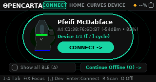
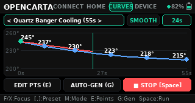

<div align="center">
  
  <h1>OpenCartaZero</h1>
  <p>
    <strong>Native Focus V Carta Sport &amp; Carta 2 Bluetooth LE Controller for the M5Stack Cardputer Zero</strong>
  </p>
  <p>
    <a href="LICENSE">
      
    </a>
    
    
    
  </p>
  <p>
    <a href="#-screenshots">Screenshots</a> •
    <a href="#-screen-by-screen-guide">Screens</a> •
    <a href="#-keyboard-controls">Controls</a> •
    <a href="#-architecture--ble-reliability">Architecture</a> •
    <a href="#-installation">Install</a> •
    <a href="PROTOCOL.md">BLE Protocol</a>
  </p>
</div>

---

**OpenCartaZero** is a native port of [**OpenCarta**](https://git.gurk.dev/gurk/OpenCarta) built specifically for the **M5Stack Cardputer Zero**. It renders directly to the `320×170` 16-bit RGB565 Linux framebuffer, reads the Cardputer's physical keyboard via raw `evdev`, and talks directly to your **Focus V Carta Sport** or **Carta 2** over **BlueZ D-Bus GATT**—no cloud, no account, no telemetry, and full feature parity with the core OpenCarta experience in the signature `#000000` / `#1ED7A6` dark-mint theme.

> **Tested Hardware:** Verified on **M5Stack Cardputer Zero** (Raspberry Pi CM0 / `CYW4343A2` BLE + `panel-mipi-dbid` `320×170` LCD) with **Focus V Carta Sport**.

---

## 📸 Screenshots

All screenshots below are captured directly from OpenCartaZero's native `320×170` framebuffer renderer:

<table>
  <tr>
    <td align="center" width="50%">
      <strong>1. BLE Discovery &amp; Connect</strong><br /><br />
      <br />
      <sub>Telink 0x0211 scan-response parsing (model, serial, live battery %, RSSI) &amp; radar rings</sub>
    </td>
    <td align="center" width="50%">
      <strong>2. Main Dashboard (Home)</strong><br /><br />
      <br />
      <sub>Live rig graphic, atomizer temp, dab counter, temp/duration sliders, presets &amp; session CTA</sub>
    </td>
  </tr>
  <tr>
    <td align="center" width="50%">
      <strong>3. Temperature Curve Studio</strong><br /><br />
      <br />
      <sub>5 built-in profiles, Smooth/Stepped interpolation, live target vs. atomizer trace &amp; playhead</sub>
    </td>
    <td align="center" width="50%">
      <strong>4. Device Settings</strong><br /><br />
      <br />
      <sub>3×3 control grid for Low Power, °C/°F, Vibe, Timeouts, Sync, Rename, BLE Log &amp; Power Off</sub>
    </td>
  </tr>
</table>

---

## 📱 Screen-by-Screen Guide

### 1. Connect (`CONNECT` Tab — Key `1`)
- **Automatic Carta Detection:** Filters BLE advertisements for the Carta GATT service (`1011123e-8535-b5a0-7140-a304d2495cb7`), Telink Semiconductor manufacturer data (`0x0211`), or Carta device names (`Pfeifi*`, `CARTA*`, `Focus*`).
- **Pre-Connect Telemetry:** Displays live battery percentage, RSSI signal strength, and device name right inside the stadium card before even opening a GATT connection.
- **Show All BLE (`A`):** Toggle to inspect every nearby BLE peripheral if your device advertises under a custom name.
- **Auto-Reconnect & Offline Mode (`O`):** Remembers your last connected Carta in `~/.config/opencartazero/state.json` and reconnects automatically on startup, or lets you explore/test curves offline.

### 2. Main Dashboard (`HOME` Tab — Key `2`)
- **Live Carta Rig Graphic:** Animated hourglass rig with glowing glass collar & base LED ring matching your active LED preset (or pulsing red during active heating), plus an **IDLE / SESH** countdown progress bar.
- **Real-Time Telemetry (`0x99` & `0xaa`):**
  - Atomizer temperature & status pill (`AMBIENT`, `PRE-HEAT`, `ACTIVE`, or `NO ATOMIZER` safety indicator).
  - Total session counter (`DABS: N` from `0xaa`).
  - Header battery badge with charging status.
- **Direct Sliders:** Adjust target **Temperature** (`150°C–340°C` / `300°F–650°F`) and **Duration** (`10s–120s`) in 5-unit steps (`[` / `]` or `,` / `/`) with live `0xcc` updates.
- **Sesh Preset Editor (`P`):** Switch between or edit all 5 stored presets (`P1`–`P5`) for both **WAX** (Concentrate) and **HERB** (Dry Herb) modes.
- **RGB LED Preset Customizer (`L`):** Turn LEDs `OFF` (Stealth), pick slots `L1`–`L5`, cycle animation modes (`ROTATE`, `PULSE`, `FADE`, `SPARKLE`, `STATIC`), and customize all 5 RGB color stops (`0xe0`–`0xe4`).
- **One-Tap Heating (`Space` / `Enter`):** Starts (`0xcc` `0xa5`) or stops (`0xcc` `0xaf`) a session immediately.

### 3. Temperature Curve Studio (`CURVES` Tab — Key `3`)
- **5 Built-in Scientific Profiles:**
  1. *Quartz Banger Cooling (55s)* — Exponential Newton decay (`245°C → 215°C`)
  2. *Live Rosin Terp Ladder (55s)* — 3-step connoisseur ladder (`210°C → 222°C → 235°C`)
  3. *Cold-Start Smooth Ramp (55s)* — Continuous ascending sweep (`205°C → 235°C`)
  4. *Live Resin Flavor → Cloud (50s)* — Balanced terp-to-cloud step profile (`220°C → 232°C → 245°C`)
  5. *Flash Melt → Mellow Finish (55s)* — Fast melt followed by a cool backend (`240°C → 212°C`)
- **Live Target vs. Atomizer Graph:** Plots the dashed/blue target curve alongside the real-time red atomizer temperature trace and moving playhead.
- **Smooth & Stepped Interpolation (`M`):** Toggle between continuous linear interpolation and stepped plateau holds.
- **Point Editor (`E`) & Auto-Generator (`G`):** Edit individual `(time, temp)` breakpoints, add/remove points, generate curves (`Exponential Decay`, `Linear Ramp`, `3-Step Terp Ladder`, `Flavor Hold -> Ramp`), and persist custom curves to `~/.config/opencartazero/curves.json`.

### 4. Device Settings (`DEVICE` Tab — Key `4`)
Compact 3×3 grid giving instant keyboard access to every device setting:
- **Low Power Mode:** Toggle `ON (20% LED)` / `OFF (80% LED)` (`0x11`).
- **Temperature Unit (`U`):** Switch live between `°C` (`0x22`) and `°F` (`0x11`).
- **Vibration Intensity:** Adjust haptic feedback from `20%` to `100%` (`0x02`–`0x0a`).
- **Sleep Mode & LED Timeout:** Set auto-sleep and LED timeouts from `1` to `15 min` (`0xd1`).
- **Sync Time:** Send `0xdd` UTC time sync & refresh all preset/LED tables without clearing the offline session log (`0xfd`).
- **Rename Device:** Type a new name (up to 29 chars) directly on the Cardputer keyboard (`0xac` + `0xaf`).
- **BLE Packet Log (`L`):** Live TX/RX packet inspector with `0x99` spam filter (`H`).
- **Power Off:** Remote shutdown (`0x11` Byte 2 = `0xaf`) with confirmation modal.

---

## ⌨️ Keyboard Controls

OpenCartaZero is designed for fast, one-handed or two-thumb Cardputer Zero operation:

| Key | Context | Action |
| :--- | :--- | :--- |
| `1` / `2` / `3` / `4` | Global | Jump directly to **CONNECT**, **HOME**, **CURVES**, or **DEVICE** |
| `Tab` | Global | Cycle to the next tab |
| `F` / `X` (or `↑` / `↓`) | Global | Move focus up / down (or scroll BLE log) |
| `Z` / `C` (or `←` / `→`) | Global | Move focus left / right (or cycle points/stops) |
| `[` / `]` (or `,` / `/`, `-` / `=`) | Global | Decrease / increase focused value, slider, preset, or option |
| `Space` / `Enter` | Home / Curves | Start or Stop heating session / active curve |
| `Enter` | Focused Item | Open modal, connect device, or apply/save changes |
| `P` / `L` | Home | Open **Sesh Preset Editor** / **LED Preset Editor** |
| `E` / `G` / `M` | Curves | Open **Point Editor** / **Auto-Generator** / toggle **Smooth vs. Step** |
| `R` / `A` / `O` | Connect | Rescan BLE / toggle **Show all BLE** / **Continue Offline** |
| `U` / `L` | Device | Quick-toggle **°C / °F** / open **BLE Packet Log** |
| `Short ESC` | Modal | Close current modal and return to tab |
| `Hold ESC (2s)` | Global | Cleanly exit OpenCartaZero back to **APPLaunch** |

---

## 🔧 Architecture & BLE Reliability

Running BLE GATT reliably on the Cardputer Zero's shared Wi-Fi/BLE radio (`CYW4343A2`) requires careful timing and BlueZ handling. OpenCartaZero implements:

1. **Zero-Dependency Native Stack:** Uses `pygame` (rendering directly to `/dev/fb0` in 16-bit RGB565), raw `/dev/input/by-path/platform-3f804000.i2c-event` `evdev` input, and `gi.repository.Gio` (System D-Bus `org.bluez`)—all pre-installed on Cardputer Zero OS.
2. **Radio Contention Prevention:** Explicitly stops LE discovery (`StopDiscovery`) before initiating `Device1.Connect()`, preventing the shared 2.4 GHz radio from dropping GATT packets during service resolution.
3. **Serialized GATT Write Queue + Coalescing:** All outgoing ATT commands pass through a single worker queue with `65 ms` pacing, and rapid live-temperature adjustments (`0xcc` `0x00`) are coalesced so slider scrubbing never floods BlueZ with `InProgress` errors.
4. **Telemetry Watchdog & Auto-Reconnect:** Marks the paired Carta `Trusted=True`, monitors `0x99` notifications, polls/re-arms `StartNotify` if notifications stall, and automatically reconnects in the background if the link drops unexpectedly.

For complete byte-level packet documentation, see [`PROTOCOL.md`](PROTOCOL.md).

---

## 🚀 Installation

### On Cardputer Zero (via SSH or Terminal)

```bash
git clone https://git.gurk.dev/gurk/OpenCartaZero.git
cd OpenCartaZero
chmod +x install.sh
./install.sh
```

`install.sh` copies the app, launcher wrapper, `.desktop` entry, and 256×256 icon into `/usr/share/APPLaunch`:
- `/usr/share/APPLaunch/apps/opencartazero/opencartazero.py`
- `/usr/share/APPLaunch/bin/opencartazero`
- `/usr/share/APPLaunch/applications/opencartazero.desktop`
- `/usr/share/APPLaunch/share/images/opencartazero.png`

Restart APPLaunch if the icon doesn't appear immediately:
```bash
sudo systemctl restart APPLaunch.service
```

### Generating Framebuffer Previews

You can render any tab to a `320×170` PNG without touching the physical display:

```bash
python3 opencartazero.py --preview screenshots/home.png home
python3 opencartazero.py --preview screenshots/connect.png connect
python3 opencartazero.py --preview screenshots/curves.png curves
python3 opencartazero.py --preview screenshots/device.png device
```

---

## 📄 License

Licensed under the [**GNU General Public License v3.0 or later**](LICENSE) (`GPL-3.0-or-later`).
