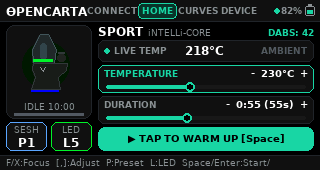
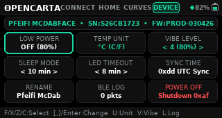

<div align="center">
  
  <h1>OpenCartaZero</h1>
  <p>
    <strong>Native Focus V Carta Sport &amp; Carta 2 Bluetooth LE Controller for the M5Stack Cardputer Zero</strong>
  </p>
  <p>
    <a href="LICENSE">
      
    </a>
    
    
  </p>
</div>

---

**OpenCartaZero** brings the full [**OpenCarta**](https://git.gurk.dev/gurk/OpenCarta) experience to the **M5Stack Cardputer Zero** (`320x170` RGB565 framebuffer + physical keyboard + BlueZ D-Bus GATT client) with the signature dark/mint (`#000000` / `#1ED7A6`) theme.

## 📸 Screenshots (320×170 Native Framebuffer)

| Connect Screen | Main Dashboard |
| :---: | :---: |
|  |  |
| **Temperature Curve Studio** | **Device Settings** |
|  |  |

## ✨ Features

- **BLE Discovery & Connect (`CONNECT` Tab):** Scans for Focus V Carta Sport / Carta 2 devices via BlueZ D-Bus (`1011123e-8535-b5a0-7140-a304d2495cb7`), parses live battery % and serial/model from Telink (`0x0211`) scan-response frames, and sends the `0xdd` UTC handshake on connect.
- **Main Dashboard (`HOME` Tab):**
  - Live atomizer temperature, target temperature, session countdown timer, battery & charging indicator, total dab counter (`0xaa`), and standby auto-off bar.
  - Direct **Temperature** (`150°C–340°C` / `300°F–650°F`) and **Duration** (`10s–120s`) sliders.
  - **Sesh Preset Editor (`P`):** Configure and save all 5 heating presets (`P1`–`P5`) for both Concentrate (Wax) and Dry Herb modes (`0xcc`).
  - **RGB LED Preset Customizer (`L`):** Switch LED slots (`OFF`, `L1`–`L5`), animation modes (`Rotate`, `Pulse`, `Fade`, `Sparkle`, `Static`), and 5 RGB color stops (`0xe0`–`0xe4`).
  - One-key **Start / Stop Session (`Space` / `Enter`)** (`0xcc` `0xa5` / `0xaf`).
- **Temperature Curve Studio (`CURVES` Tab):**
  - All 5 built-in profiles (*Quartz Banger Cooling Curve*, *Live Rosin Terpene Ladder*, *Cold-Start Smooth Ramp*, *Live Resin Flavor → Cloud*, *Flash Melt → Mellow Finish*) plus custom saved curves (`~/.config/opencartazero/curves.json`).
  - **Smooth** or **Stepped** interpolation, live target vs. atomizer graphing, interactive **Point Editor (`E`)**, and **Curve Auto-Generator (`G`)**.
- **Device Settings (`DEVICE` Tab):**
  - Toggle **Low Power Mode** (`20%` vs `80%` LED), **°C / °F Unit**, **Vibration Intensity** (`20%`–`100%`), **Sleep Timeout** & **LED Timeout** (`1–15 min`, `0xd1`), **UTC Time Sync** (`0xdd`), **Device Rename** (`0xac` + `0xaf`), **Live BLE Packet Log**, and **Remote Power Off** (`0x11` `0xaf`).

## ⌨️ Keyboard Controls

| Key | Action |
| :--- | :--- |
| `1` / `2` / `3` / `4` or `Tab` | Switch between **CONNECT**, **HOME**, **CURVES**, **DEVICE** tabs |
| `F` / `X` (or `Up` / `Down`) | Move focus up / down |
| `Z` / `C` (or `Left` / `Right`) | Move focus left / right |
| `[` / `]` (or `,` / `/`) | Decrease / increase selected value, temperature, timer, or preset |
| `Space` / `Enter` | Start / Stop heating session or activate focused control |
| `P` / `L` (on Home) | Open **Sesh Preset Editor** / **LED Preset Editor** |
| `E` / `G` / `M` (on Curves) | Open **Point Editor** / **Auto-Generator** / toggle **Smooth vs. Step** |
| `Short ESC` | Close active modal |
| `Hold ESC (2s)` | Cleanly exit OpenCartaZero back to APPLaunch |

## 🚀 Installation on Cardputer Zero

```bash
chmod +x install.sh
./install.sh
```

## 📄 License

Licensed under the [**GNU General Public License v3.0 or later**](LICENSE) (`GPL-3.0-or-later`).
